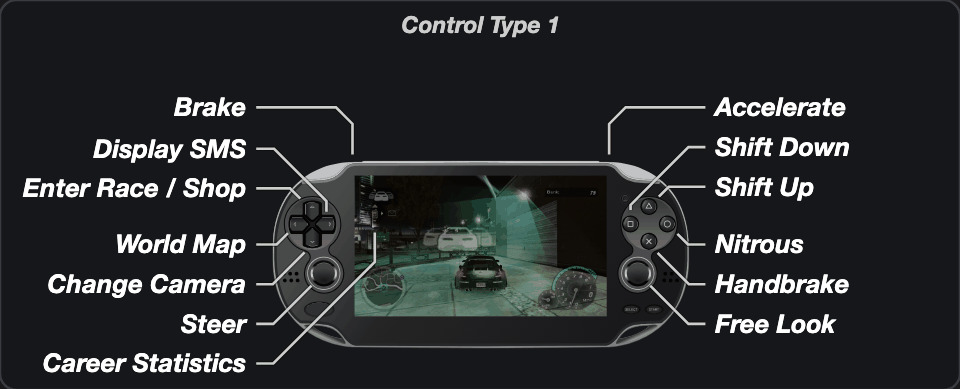
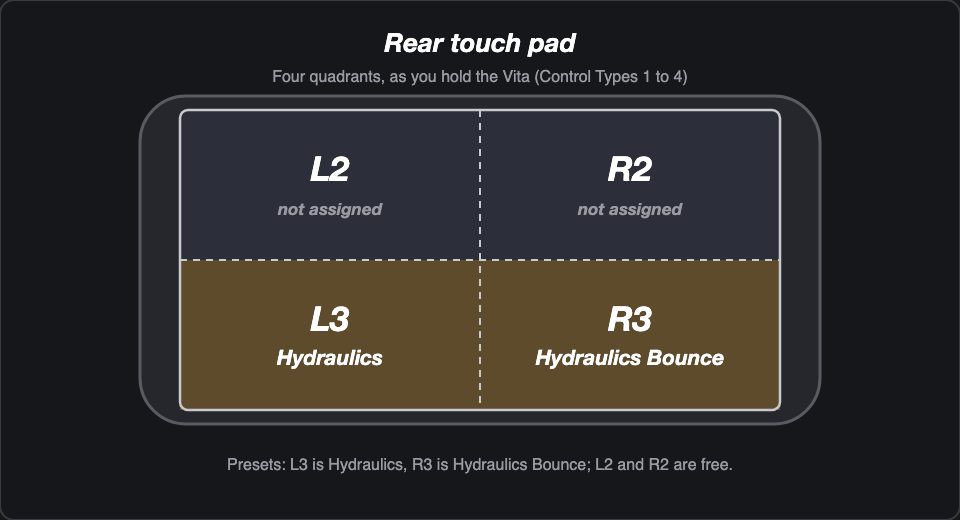

# Need for Speed Underground 2 for the PS Vita

A fan project that enables you to play your own PC copy of Need For Speed Underground 2 (Version 1.2) on your PS VITA. This is not the game files for Need For Speed Underground 2. You must provide your own legally obtained copy of the game. This project provides a compatibility layer along with performance optimisations to allow the PC version of the game to run on a PS VITA system.

[Install](#install) · [Controls](#controls) · [Settings](#settings) · [Report Bug](../../issues)

> **Playtest.** The game is playable in all aspects. The entire career mode is working, and the framerate is good in most scenes.
> Expect rough edges.

## Requirements

- Need for Speed Underground 2 for PC, installed (your own copy). The whole game folder is needed, about 1.7 GB.
- The port is only compatible the US Version 1.2 `SPEED2.EXE`, the one with SHA-256
  `f9dd86c054878ce6276beb07c1fd61874f7a1e4bf1f241b084c65b73e24168a7`. See [Mods](#mods).
- PS Vita with HENkaku / Ensō and [VitaShell](https://github.com/TheOfficialFloW/VitaShell)
- About 2.5 GB free on the memory card
- Only if you build the VPK yourself instead of downloading it: a Mac with Apple silicon or an x86-64 Windows PC
  (see [Build](#build)). These are the two kinds of computer the build is tested on.
- [PSVshell](https://github.com/Electry/PSVshell) is optional but recommended in this playtest state: overclocking
  the CPU to 500 MHz with it increases performance.
- [CapUnlocker](https://github.com/GrapheneCt/CapUnlocker) is optional but recommended: it lets the port use the Vita's fourth
  CPU core.

The port sets the Vita's CPU and GPU clocks itself, so the game runs without an overclocking plugin.

## Install

1. Download `NFSU2VITA.vpk` from the [Releases](../../releases) page. You can also build it yourself from your game
   folder (see [Build](#build)).
2. Copy `NFSU2VITA.vpk` to the Vita and install it with VitaShell.
3. On your computer, open the game folder (the one with `SPEED2.EXE`) and copy **everything inside it**, every file
   and folder including `MOVIES`, to `ux0:data/NeedForSpeedUnderground2/` (VitaShell's FTP or USB mode works).
   `SPEED2.EXE` must end up at `ux0:data/NeedForSpeedUnderground2/SPEED2.EXE`, not in a subfolder.
4. Start the game from the home screen.

If the game closes right away, `ux0:data/NeedForSpeedUnderground2/NeedForSpeedUnderground2.log` says what is missing.

Your career is saved in `ux0:data/NeedForSpeedUnderground2/save/`. Copy that folder to back it up.

### Icon and LiveArea images

The downloadable VPK has the game's logo on its icon and LiveArea start button. The images in this repository are
plain ones with the game's name as text; a script makes the logo ones from your own game files. It needs only
[Python 3](https://www.python.org/downloads/) and a copy of this repository.

If you build the VPK yourself, `tools/build.py` makes the logo images from your game folder as part of the build.
To put them on a VPK that has plain ones, without building again:

```sh
python3 -I tools/vita/livearea_art.py "<game folder>" --vpk NFSU2VITA.vpk
```

```sh
python3 -I tools/vita/livearea_art.py --images "<your folder>" --vpk NFSU2VITA.vpk
```

### PC save files

Save files from the PC game work. On the PC each profile is a folder named after the profile, in
`%LocalAppData%\NFS Underground 2\`. Copy that folder, with the file inside it, to

```
ux0:data/NeedForSpeedUnderground2/save/NFS Underground 2/<profile name>/
```

so a profile called `Player` ends up as `ux0:data/NeedForSpeedUnderground2/save/NFS Underground 2/Player/Player`. 

### Movies

The game's movies are the `.vp6` files in its `MOVIES` folder, and the port needs them there. On their own they
are decoded in software. Converted `.mp4` files beside them are optional and faster; `movies=vp6preferred` (the default) uses them when present, `movies=vp6only` always decodes the `.vp6`.

## Controls

The Vita appears to the game as a PlayStation 2 controller. Control Type 1, the default, is shown below; change the
controls in the game's Options > Controls (Joypad Configuration). Text fields, such as a profile name, open the Vita
keyboard, the touch screen taps menu items like a mouse click.

The touch screen is also used in Career free roam to handle Enter Race / Shop, and opening the World map, SMS and Career statistics menus.



The rear touch pad is split into four quadrants: L2 and R2 at the top, L3 and R3 at the bottom. 



## Settings

### Start-up screen

The VPK holds two programs: `eboot.bin`, a small launcher with the start-up screen and settings manager, and
`game.bin`, the game. 

Each time the game starts it first shows a short screen: press START to open the settings manager, or any other
button to start the game at once; after 3 seconds it starts by itself. `show_configurator_on_boot=off` in the settings file turns the screen off: the launcher then starts the game
at once.

The manager has two tabs, switched with L and R: **Mods** for PC mod features (see [Mods tab](#mods-tab)) and
**Config** for the port's own settings, every key of the settings file by group. Triangle shows or hides the dev settings (`dev_` keys and the Developer group) on Config, and the mod settings the port does not support yet on Mods; both start hidden.

### Mods tab

The start-up screen's Mods tab switches PC mod features the port has rebuilt itself, grouped by the mod they come
from. Each feature keeps its setting in the mod's own settings file, shared with the PC game, so a PC mod
user's file works as it is. The game is vanilla by default: with no settings file a mod is off, and a key (or section)
missing from the file leaves the game as it is for that key, unlike the PC mod, which then uses its own default. Each
row's default is the value that leaves the game unchanged; three Extra Options keys have none (`[LapControllers]
Minimum`, `[Drift] MaximumMultiplier`, `[Gameplay] StartingCash`), so their first choice is Vanilla, which leaves the
key out of the file. Without the file, Save creates it with every key at that vanilla value except the ones you
changed; with an existing file only the changed keys are changed in place (Vanilla removes the key's line), every other
line left as it was. Numbers step with Left and Right within the mod's range, Square sets a row back to vanilla, and
holding Select does that for the whole tab.

The settings files are under the game folder, `ux0:data/NeedForSpeedUnderground2/`, and can be edited by hand.

| Entry | Settings file | Needs |
|-------|---------------|-------|
| ExtraOptions 5.1.0.1340 by ExOpts Team: EU Car Content | `scripts/NFSU2ExtraOptionsSettings.ini`, `UnlockRegionalCars = 1` in `[Gameplay]` | `CARS/CORSA` and `CARS/PEUGOT106`, each with `GEOMETRY.BIN`, `TEXTURES.BIN`, `VINYLS.BIN` and `PARTS_ANIMATIONS.bin`, copied from a European PC copy of the game |
| ExtraOptions 5.1.0.1340 by ExOpts Team: the options below | the same file, `[LapControllers]` `Minimum`, `Maximum`; `[Drift]` `MaximumMultiplier`, `PlusSign`, `ShowWithoutMultiplying`, `HideNiftyDriftMessages`; `[Menu]` `ShowOutrun`, `ShowSubs`, `ShowSpecialVinyls`, `AnyTrackInAnyRaceMode`, `FreeRunTrackSelect`, `OutrunTrackSelect`; `[Gameplay]` `EnableHiddenCameraModes`, `RemoveRaceBarriers`, `RemoveLockedAreaBarriers`, `ShowPercentOn1LapRaces`, `StartingCash`, `UnlockAllThings`, `NeonBrightness` | nothing more |
| NFSU/NFSU2 Visual Reputation Remover 1.1 by thelink2012: Visual Rating Removal | `scripts/NFSU2VitaNoVisualRep.ini`, `RemoveVisualRep = 1` in `[NFSU2]`; the mod has no settings file, so the port's own | nothing more |

### Settings file

With nothing changed the game runs locked to 30 frames a second, in widescreen, with the touch screen as a replacement for a mouse.

Two fixes from NFSU2 Extra Options are always on and have no setting: cracked glass and other car damage show
outside the crash camera too (DamageFix), and the Megalow performance shop shows its own scenery (MegalowPartsFix).

The first time the game starts it writes a settings file, `ux0:data/NeedForSpeedUnderground2/NeedForSpeedUnderground2.cfg`.
Every setting in it is listed at its default behind a `#`. To change one, remove the `#` at the start of its line,
edit the value and start the game again, for example:

```
frame_rate=0
```

Delete the file to get a fresh copy on the next start.

Settings that start with `dev_` are experiments that may change or go away. 

The first start writes graphics values tuned for the Vita. The game's own Display menu changes them, and they are
kept between sessions. The resolution stays at 960x544.

## Mods

Existing PC mods will slowly be added to the port over its development.

### NFSU2 Extra Options

With its settings file in place the game works as with Extra Options 5.1.0.1340 on the PC for the options in the Mods
tab table, for each key the file has: a key that is missing leaves the game as it is, including the changes the mod
would make whatever the key says (the lap limits, the drift multiplier's thresholds and score factor, the game region,
the starting cash of a new career, the neon brightness). The hotkeys, the weather, sound and window options and the rest stay unsupported and are
never read. The port changes the same game code and data the mod changes, and reads the values the same way: a key
that is not a number takes the mod's code default, a decimal that is not a number reads as 0. `AnyTrackInAnyRaceMode`
and `UnlockAllThings` are read at start-up only; there is no hotkey.

## Build

You need your installed copy of the game and [Python 3](https://www.python.org/downloads/). One command does the
rest, on a Mac with Apple silicon or an x86-64 Windows PC (Linux is set up the same way but untested):

```sh
python3 tools/build.py "<folder with SPEED2.EXE>"   # -> build-vita/NFSU2VITA.vpk
```

It uses [VitaSDK](https://vitasdk.org) and [LLVM](https://llvm.org) (clang 22.1.8 or newer, with lld) if they
are installed, found through `VITASDK`, `NFSU_LLVM`, `PATH` or Homebrew, and [CMake](https://cmake.org) and
[Ninja](https://ninja-build.org) if they are on `PATH`. For anything missing it asks whether to download it or use a
folder you name. Downloads are pinned versions, checked against their publishers' checksums, about 1.1 GB in all on
Windows and 1.7 GB on macOS or Linux; they go once into `vita-tools` in your home folder, which later builds reuse
(`--download-tools` answers yes in advance). The first build takes a while; later ones only redo what changed.

By hand, with VitaSDK, LLVM, CMake 3.20 or newer and Ninja installed, from the repository root:

```sh
# 0. Where VitaSDK and LLVM are installed (your paths may differ)
export VITASDK=/usr/local/vitasdk
export NFSU_LLVM=/usr/local/opt/llvm

# 1. Recompiled game code from your game folder (about 5 minutes)
python3 tools/recompiler/generate.py --game ug2 --binaries "<game folder>" --out src/ug2/generated \
    --float-align all --inline-ftol2 --pure-natives --native-writes --promote-stack-slots --fold-rdata

# 2. Effect tables from the same executable
python3 -I tools/fx/fxtable.py --exe "<game folder>/SPEED2.EXE" --out include/winapi/d3d9_fxtables.h

# 3. Optional: icon and LiveArea images with the game's logo, from your game files
python3 -I tools/vita/livearea_art.py "<game folder>"

# 4. The VPK
cmake -S . -B build-vita -G Ninja -DCMAKE_BUILD_TYPE=Release -DNFSU_GAME_OPT=-O2
ninja -C build-vita                                    # -> build-vita/NFSU2VITA.vpk
```

- The port has only been tested with the executable named under [Requirements](#requirements). With any other the
  build prints a warning that it may not work and asks before continuing; see [Mods](#mods).
- The build uses the profile in `pgo/` by default; `pgo/README.md` explains how it was recorded.
- The icon and LiveArea images in `sce_sys/` are plain. Step 3 makes ones with the game's logo from your own game
  files into `sce_sys/game/`, which the build uses when it is there; run it before `cmake`. See
  [Icon and LiveArea images](#icon-and-livearea-images).
- Shaders ship prebuilt in `shaders/gxp/`.
- The build uses clang and lld only.

| Path | Contents |
|------|----------|
| `include/` | virtual x86 CPU, runtime, Win32 and platform headers |
| `src/lib/` | runtime: guest memory, threads, Win32, C runtime, Direct3D 9 and D3DX |
| `src/platform/` | Vita backend: GXM renderer, audio, input, sync, logging |
| `src/ug2/` | entry point, native replacements of game functions |
| `shaders/` | Cg shaders and compiled binaries |
| `tools/` | recompiler and build scripts |

### Build options

These are CMake options. A normal build sets none of them; to change one, add it to the `cmake` line of step 4, for
example `-DDEV_SETTINGS=ON`.

| Option | Default | What it does |
|--------|---------|--------------|
| `NATIVE_FUNCTIONS` | `ON` | Uses the port's hand-written native versions of game functions. `OFF` uses their translated originals |
| `AUDIO_FAST_PATHS` | `ON` | Uses the native and NEON routines in the audio mixer. `OFF` uses the plain ones |
| `RENDER_FAST_PATHS` | `ON` | Uses the fast paths of the Direct3D layer and the renderer. `OFF` uses the straightforward ones |
| `DEV_SETTINGS` | `OFF` | For development: the settings file can switch each of these choices one by one, without a rebuild |
| `NFSU_LAUNCHER` | `ON` | The VPK's `eboot.bin` is the launcher (start-up screen and settings manager) and the game is `game.bin`. `OFF` packs the game alone as `eboot.bin`. `build-vita/NFSU2VITA.self` is the game alone either way |
| `DEV_TOOLS` | `OFF` | For development: compiles the diagnostics from `src/dev` (hitch log, mixer counters, benchmark figures, test driver, scene log). Releases do not include them |

With `DEV_SETTINGS=OFF` the three choices are fixed when the program is compiled, and settings for them in the
settings file are ignored. With `DEV_SETTINGS=ON` each choice has its own key there, for example `matrix4_native=off`,
and the option above is only its default. The first lines of the log say which kind of build is running when
`log_info=on`.

With `DEV_TOOLS=OFF` the settings of those diagnostics (`hitch_log`, `dev_mixer_stats`, `scene_log`, `scene_log_frames`, `offload_count`, `d3d_record_test`,
`benchmark_seconds`, `benchmark_window`, `benchmark_frames`, `benchmark_exit`, `boot_drive`, `boot_drive_seed`) are ignored.

## Credits

- [UG1VITA](https://github.com/NDRWhun/UG1VITA): the Need for Speed Underground port this project grew out of
- [GrapheneCt](https://github.com/GrapheneCt): CapUnlocker
- [Electry](https://github.com/Electry): PSVshell
- [ThirteenAG](https://github.com/ThirteenAG): the WidescreenFixesPack, read as a guide to what a wider picture
  needs fixed; none of its code is used
- [nfsu2-recompiled](https://github.com/codepdbh/nfsu2-recompiled): another recompilation of the same game, read as
  a reference for how the game works; none of its code is used

## License

MIT for the port's own code ([LICENSE](LICENSE)); third-party parts: [THIRD_PARTY.md](THIRD_PARTY.md).

Unofficial, non-commercial fan port, not affiliated with or endorsed by Electronic Arts. *Need for Speed* is a
trademark of Electronic Arts. You must own the game.

## Contributions

Pull requests are welcome. Changes to engine behaviour are accepted when their purpose is performance: for example cheaper particles or more aggressive level of detail which only affect visual fidelity. They should be behind a setting, say what they change visually, and come with a before and after measurement on a real Vita.

Integrating existing PC mods is also very welcome and made easier with the modding skill for AI coding agents, [`.claude/skills/modding/SKILL.md`](.claude/skills/modding/SKILL.md), which `AGENTS.md` points to

Changes to core gameplay (handling, AI, career) are out of scope unless there is a very specific reason, e.g a bug that existed even in the PC version. 
